<div align="center">


# EventSphere

**Discover, book and manage events across India.**
A full-stack event platform built with React, Tailwind CSS, Express and MongoDB Atlas.

[**Live site → eventsphere-events.vercel.app**](https://eventsphere-events.vercel.app) ·
[API health](https://eventsphere-api-dbb6.onrender.com/api/health) ·
[Screenshots](#-screenshots) ·
[Run it locally](#%EF%B8%8F-run-it-locally)


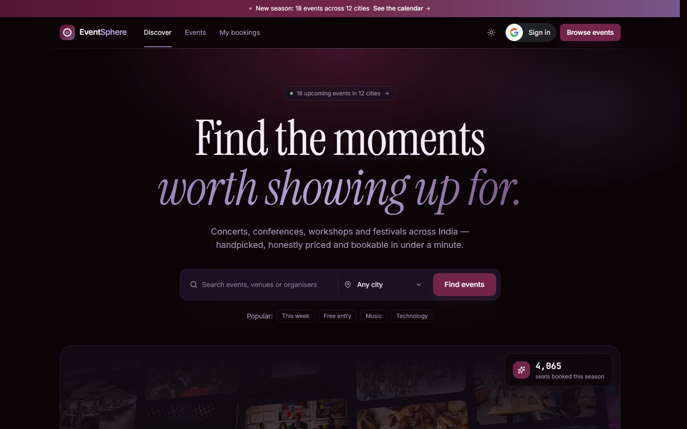

</div>

> **K Explore – Web Designing task:** *Design and develop a responsive event management website.*
> Version 2.0 rebuilds the original HTML/CSS/JavaScript site as a React application with its own API and database.

---

## Contents

- [Highlights](#-highlights)
- [Design](#-design)
- [The brief, point by point](#-the-brief-point-by-point)
- [Tech stack](#-tech-stack)
- [Architecture](#%EF%B8%8F-architecture)
- [Project structure](#%EF%B8%8F-project-structure)
- [API](#-api)
- [Run it locally](#%EF%B8%8F-run-it-locally)
- [Deployment](#%EF%B8%8F-deployment)
- [Screenshots](#-screenshots)

---

## ✨ Highlights

- **Editorial, professional layout** — serif headlines, hairline grids and a restrained wine-and-lavender palette; dark by default with a light “lavender mist” theme.
- **DriftWall showcase** — the [React Bits](https://reactbits.dev) DriftWall component turns every upcoming event into a drifting perspective wall. Hover lifts a tile; click opens the event.
- **Liquid-glass navigation** — the floating navbar, every tab bar, the grid/list toggle and the mobile booking bar sit on React Bits GlassSurface, which refracts whatever scrolls underneath.
- **Calendar you can steer** — *What’s on, week by week* is a React Bits AnimatedList: hover or use ↑/↓ and Enter to move through the next twelve events.
- **Deliberate commitments** — bookings are confirmed with a slide-to-book control (SlideCommit) and cancelled with a press-and-hold button (HoldButton), so neither can happen by accident.
- **Serious filtering** — multi-select categories, date ranges, price bands, city, sorting, grid and calendar views, pagination — all reflected in the URL so results can be shared.
- **Three-step checkout** — details → seats → review, validated as you type, with an order summary and server-side checks that can’t be bypassed.
- **Bookings that survive anything** — saved in MongoDB *and* in the browser’s Local Storage, synced with your Google account, exportable to CSV/JSON and importable again.
- **QR passes** — every booking gets a pass with a QR code, live countdown, calendar export and a print layout.

## 🎨 Design

| Swatch | Name | Hex | Role |
| --- | --- | --- | --- |
|  | Wine | `#541533` | Gradients, glows, pass background |
|  | Plum | `#722548` | Primary buttons, active states, light-mode accent |
|  | Night | `#221932` | Raised surfaces in dark mode, light-mode text |
|  | Ink | `#0B0407` | Dark-mode canvas |
|  | Dusk | `#77568B` | Secondary accent, gradient end |
|  | Lavender | `#9682B9` | Dark-mode accent, focus rings, countdowns |

- **Type:** Instrument Serif for headlines (with italics for emphasis), Inter for interface text, JetBrains Mono for numbers, dates and booking references.
- **Layout:** a 1,240 px grid, 1 px hairline dividers, consistent 20 px radii and generous spacing — closer to a ticketing product than a template.
- **Motion:** spring-based tab indicators, staggered card entrances, scroll reveals and the DriftWall — all reduced automatically for people who prefer less motion.
- **React Bits components** were added with the shadcn CLI (`npx shadcn@latest add @react-bits/<Name>-JS-CSS`, registry in `frontend/components.json`) and are vendored in `frontend/src/components/`. Each one is wrapped in a small themed component so it follows the palette and the light/dark switch:

  | Component | Where it is used | Wrapper |
  | --- | --- | --- |
  | DriftWall | Home page showcase wall | `showcase.jsx` |
  | AnimatedList | *What’s on, week by week* calendar | `agenda.jsx` |
  | GlassSurface | Navbar, tab bars, view toggle, mobile booking bar | `glass.jsx` |
  | SpecularButton | *Browse events* and *Find events* buttons | `specular.jsx` |
  | SlideCommit | Confirming a booking at checkout | `commit.jsx` |
  | HoldButton | Cancelling a booking in My Bookings | `commit.jsx` |

  Small, commented changes to the vendored code: DriftWall gained an `onSelect` callback and a `decorative` mode, and SpecularButton only releases its WebGL context once its canvas has left the page (React’s StrictMode re-runs effects on the same canvas in development).

## ✅ The brief, point by point

| Requirement | Where |
| --- | --- |
| Attractive hero section | `pages/Home.jsx` — editorial headline, search with city filter, popular shortcuts |
| Upcoming & featured events | DriftWall showcase, *Handpicked for this season* (category tabs), *What’s on, week by week* calendar |
| Event cards with name, date, venue, image, description | `components/events.jsx` → `EventCard` and `AgendaRow` |
| Browse, search, filter by category | `pages/Events.jsx` — debounced search, multi-category, date, price, city, sort, grid/list, pagination |
| Event details with a registration option | `pages/EventDetail.jsx` — overview, schedule, venue map, FAQ, sticky booking card |
| Form with name, email, phone and selected event | `pages/Checkout.jsx` — event selector, name, email, +91 mobile, optional city, seats |
| JavaScript form validation | `lib/validation.js` (unit tested) — on blur, live after first touch, per step, focus moves to the first problem |
| Confirmation message | Success banner, confetti and a QR pass on `/bookings/:reference` |
| Responsive on phones, tablets and desktops | Mobile menu, slide-over filters, sticky mobile booking bar, fluid type |
| **Bonus:** dark/light mode | `hooks/theme.jsx` — saved preference, cross-fade via the View Transitions API |
| **Bonus:** countdown timers | Booking card, *Next up* card, pass page and every upcoming booking |
| **Bonus:** animations | Motion (Framer Motion), React Bits (DriftWall, AnimatedList, GlassSurface, SpecularButton, SlideCommit, HoldButton), Lenis smooth scrolling |
| **Bonus:** Local Storage registrations | `lib/bookings-store.js` + My Bookings — view, cancel, sync, export CSV/JSON, import, clear |
| Git, GitHub, deployment, README | This repository, CI on every push, Vercel + Render + MongoDB Atlas |

### Validation rules

| Field | Rule |
| --- | --- |
| Event | Must be selected; sold-out and past events can’t be booked |
| Full name | 3–60 characters, letters in any script (incl. Hindi, Bengali, Tamil), spaces, `.` `'` `-` |
| Email | Valid address, no spaces; one active booking per email per event |
| Mobile | Indian number, 10 digits starting 6–9; `+91`, `0` and spaces are accepted and normalised |
| Seats | 1–6, never more than the seats left |
| Terms | Must be accepted on the review step |

The API repeats every check with Zod, and seat reservation is atomic, so two people can’t take the last seat at the same time.

## 🧰 Tech stack

| Layer | Tools |
| --- | --- |
| Frontend | React 19, Vite 8, Tailwind CSS 4, React Router 7, TanStack Query 5, Motion, Lenis, Sonner, qrcode.react, canvas-confetti, Lucide icons |
| UI components | React Bits **DriftWall, AnimatedList, GlassSurface, SpecularButton, SlideCommit, HoldButton** (installed with the shadcn CLI) |
| Backend | Node.js 22, Express 5, Mongoose 9, Zod 4, google-auth-library, JSON Web Tokens, Helmet, express-rate-limit |
| Database | MongoDB Atlas (AWS Singapore) |
| Sign-in | Google Identity Services — Sign in with Google button and One Tap |
| Hosting | Vercel (web + `/api` proxy), Render (API) |
| Quality | ESLint, Vitest, GitHub Actions |

## 🏗️ Architecture

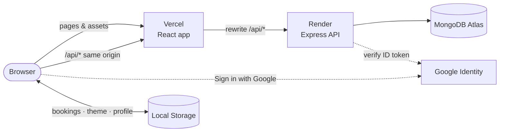

- The browser only talks to one origin: Vercel forwards `/api/*` to Render, so the session cookie is first-party and works even where third-party cookies are blocked.
- Event lists are cached at Vercel’s edge for a few seconds (`s-maxage` + `stale-while-revalidate`), keeping pages fast even while the free API instance wakes up.
- Local Storage is the offline copy; the API is the source of truth (`POST /api/bookings/lookup` reconciles them).

## 🗂️ Project structure

```
.
├── frontend/                 React app (deployed to Vercel)
│   ├── components.json       shadcn config — used to install the React Bits components
│   ├── public/
│   └── src/
│       ├── components/       React Bits components + themed wrappers, layout, events, ui kit
│       ├── hooks/            theme, Google session, data queries, countdown
│       ├── lib/              api client, validation (+ tests), bookings store, formatting
│       ├── pages/            Home, Events, EventDetail, Checkout, Bookings, BookingDetail, Legal
│       └── styles/index.css  design tokens and utilities
├── backend/                  Express API (deployed to Render)
│   └── src/
│       ├── modules/          events · bookings · auth · newsletter
│       ├── models/           Event, Booking, User, Subscriber
│       ├── lib/              validation middleware, session cookie, booking references
│       └── seed/             20 events (the original 12 + 8 new) and the seed script
├── docs/screenshots/
├── vercel.json               build settings and the /api rewrite
└── render.yaml               Render blueprint for the API
```

## 🔌 API

Base URL: `https://eventsphere-events.vercel.app/api`

| Method | Path | Purpose |
| --- | --- | --- |
| `GET` | `/health` | Status and database connection |
| `GET` | `/events` | List events — `q`, `category` (comma-separated), `city`, `price` (`free`, `under-1000`, `1000-2500`, `over-2500`), `when` (`upcoming`, `week`, `month`, `quarter`, `past`, `all`), `sort`, `page`, `limit` |
| `GET` | `/events/facets` | Category and city counts, season totals |
| `GET` | `/events/:slug` | One event plus similar events |
| `POST` | `/bookings` | Book seats `{ eventId, name, email, phone, city?, seats }` |
| `GET` | `/bookings/:reference` | A booking (contact details masked unless it’s yours) |
| `POST` | `/bookings/:reference/cancel` | Cancel with `{ email }`, or as the signed-in owner |
| `POST` | `/bookings/lookup` | Statuses for a list of references (Local Storage sync) |
| `GET` | `/bookings/mine` | Your bookings (signed in) |
| `POST` | `/auth/google` | Sign in with a Google ID token `{ credential }` |
| `GET` · `POST` | `/auth/session` · `/auth/signout` | Current session · sign out |
| `POST` | `/newsletter` | Subscribe `{ email, interests[] }` |

Validation errors return `422` with per-field messages, for example `{ "message": "Some details need another look", "fields": { "phone": "Enter a valid 10-digit Indian mobile number" } }`.

## 🛠️ Run it locally

You need Node.js 20.12+, a MongoDB connection string and a Google OAuth *Web* client ID with `http://localhost:5173` as an authorised JavaScript origin.

```bash
git clone https://github.com/Sushmita-Sen25/Event_mangement_website.git
cd Event_mangement_website

# API
cd backend
cp .env.example .env          # fill in DATABASE_URL, SESSION_SECRET, GOOGLE_CLIENT_ID
npm install
npm run seed                  # loads the 20 events
npm run dev                   # http://localhost:5000

# Web app (second terminal)
cd frontend
cp .env.example .env.local    # set VITE_GOOGLE_CLIENT_ID
npm install
npm run dev                   # http://localhost:5173 — /api is proxied to :5000
```

| Command | Folder | Does |
| --- | --- | --- |
| `npm run dev` | both | Start with live reload |
| `npm run build` | frontend | Production build into `frontend/dist` |
| `npm run lint` · `npm test` | frontend | ESLint · Vitest unit tests |
| `npm run seed` · `npm run seed:fresh` | backend | Upsert events · wipe events and bookings, then reseed |

## ☁️ Deployment

| Part | Where | Notes |
| --- | --- | --- |
| Web app | [Vercel](https://eventsphere-events.vercel.app) | Built from `frontend/` via `vercel.json`; `/api/*` rewritten to Render; `VITE_GOOGLE_CLIENT_ID` set in the project |
| API | [Render](https://eventsphere-api-dbb6.onrender.com/api/health) | Free web service in Singapore, `rootDir: backend`, health check `/api/health` |
| Database | MongoDB Atlas | `eventsphere` database with its own least-privilege user |
| Keep-alive | GitHub Actions | Pings the API every 10 minutes so the free instance stays warm |

## 📸 Screenshots

| | |
| --- | --- |
|  | 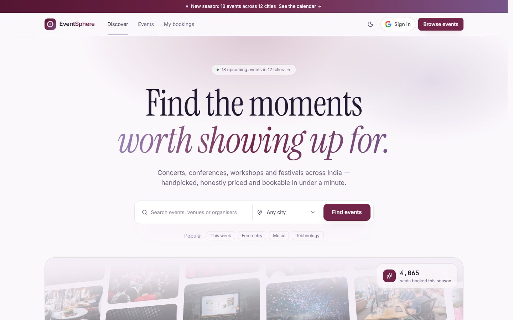 |
| 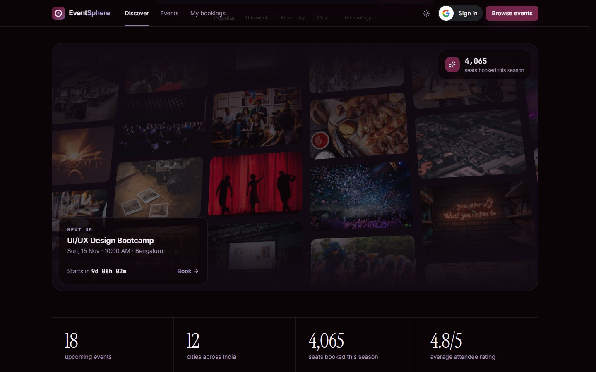 | 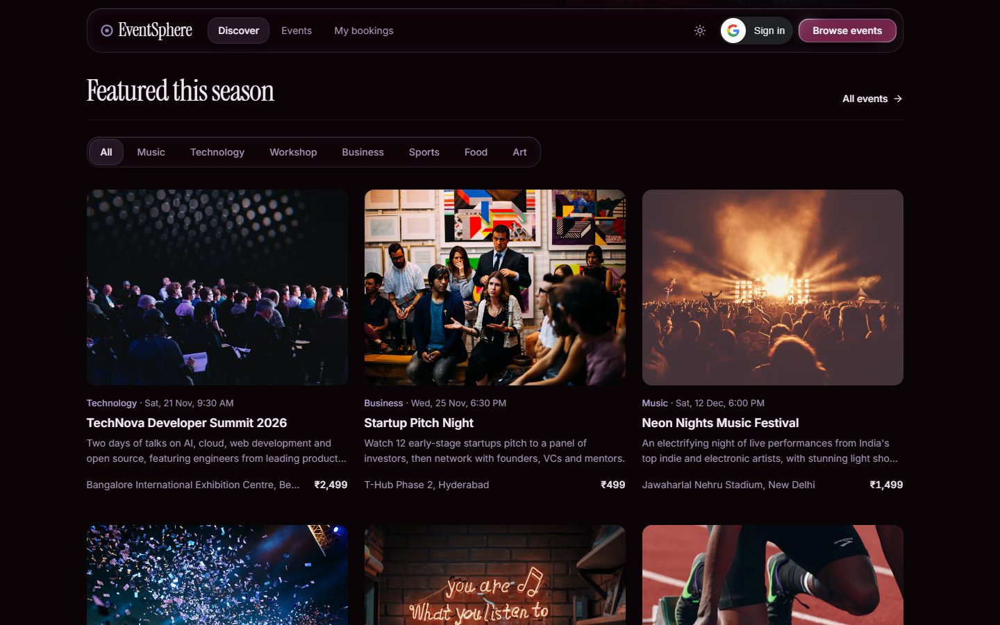 |
| 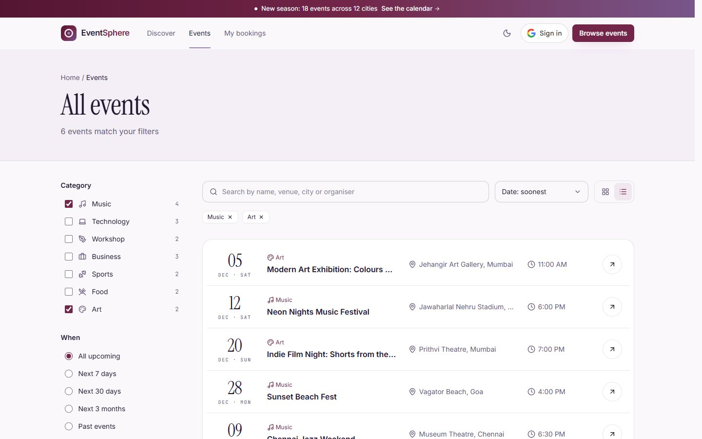 | 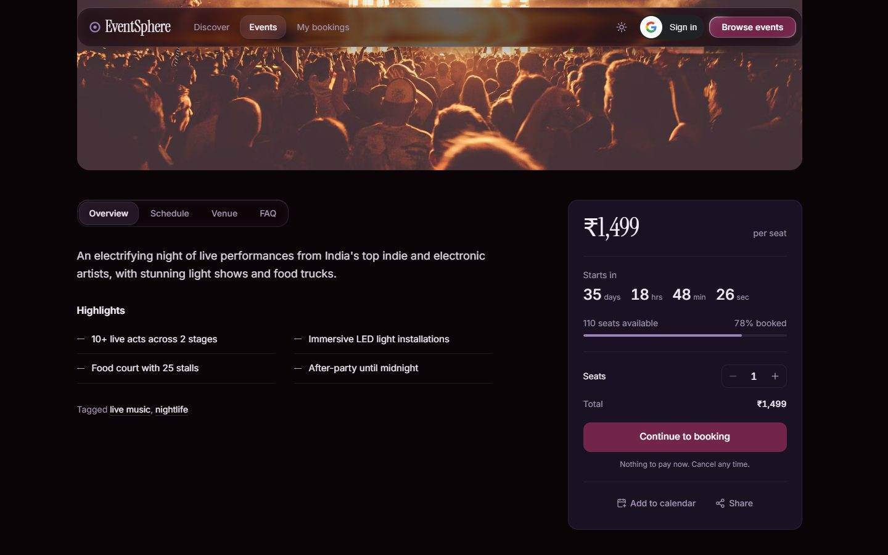 |
| 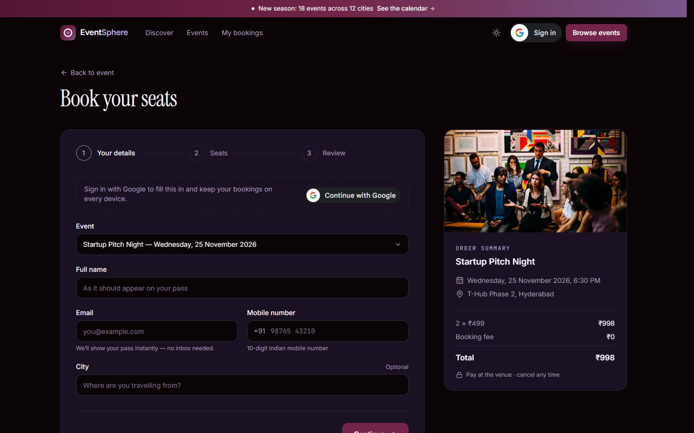 | 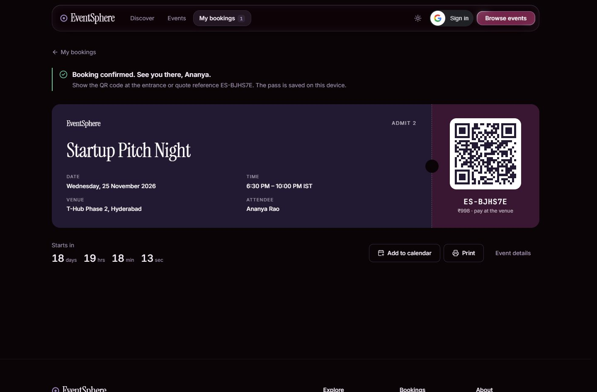 |

<p align="center">
  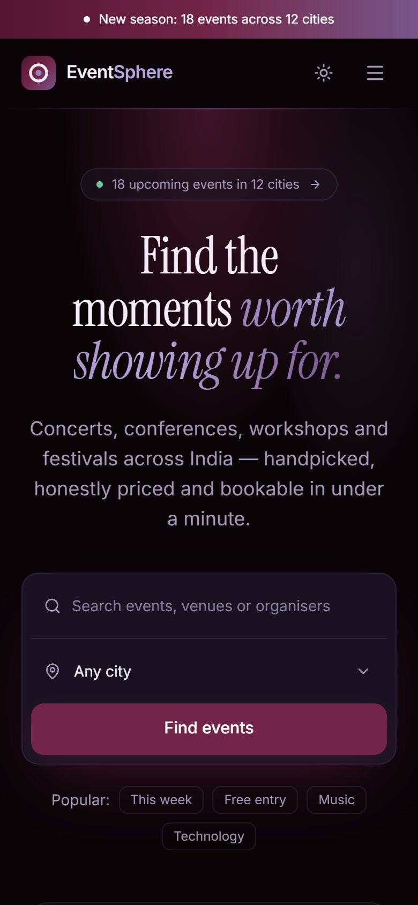
  &nbsp;
  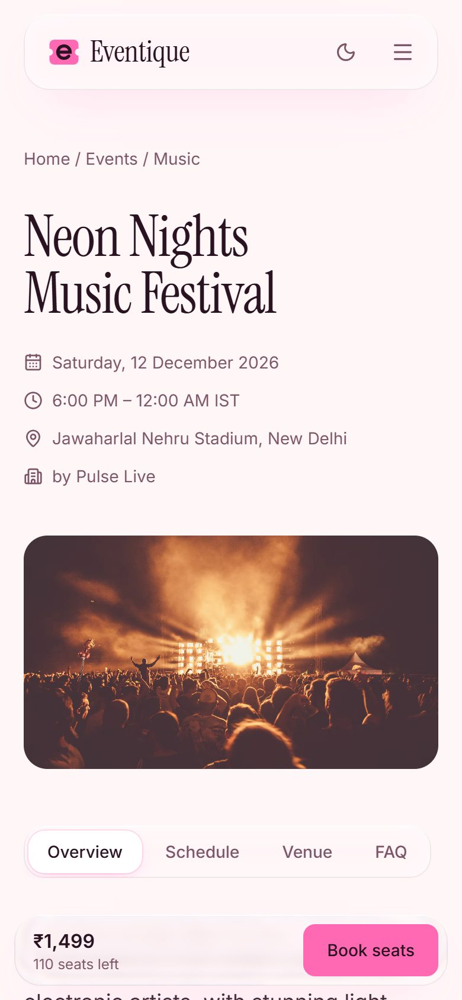
</p>

## Credits

- DriftWall, AnimatedList, GlassSurface, SpecularButton, SlideCommit and HoldButton by [React Bits](https://reactbits.dev) (MIT + Commons Clause); icons inside SlideCommit from [Hugeicons](https://hugeicons.com).
- Event photography from [Unsplash](https://unsplash.com); maps © OpenStreetMap contributors.
- Events, organisers and prices are sample data for this project.

<div align="center"><sub>Built for <b>K Explore — Web Designing</b> · React · Tailwind CSS · Express · MongoDB</sub></div>
